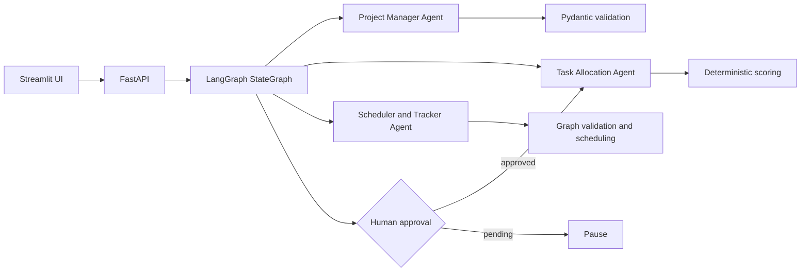

# Architecture

## Actual MVP Boundary

The running MVP uses FastAPI as the transport layer, Pydantic contracts at the boundary, deterministic algorithms in `backend/app/algorithms`, three agents in `backend/app/agents`, and a LangGraph StateGraph in `backend/app/orchestrator`. The Streamlit app calls the HTTP API and does not invent project data.

## Shared State

`WorkflowState` contains project input, validated analysis, team profiles, allocation proposals, schedule, current stage, agent outputs, errors, and execution metadata. Secrets and API keys are excluded.

## Human-in-the-Loop

The graph always produces a draft analysis first. A pending approval routes to an explicit terminal pause. Allocation and scheduling are reachable only when the workflow input carries `approval_status=approved`. The API tests cover both paths.

## Provider Boundary

The current provider is a controlled mock used for local execution and tests. The agent contracts are isolated behind `BaseAgent`; a live OpenAI provider can be added without changing deterministic validation or scheduling.

## Current Persistence Status

The first vertical slice is intentionally stateless and runs without PostgreSQL. PostgreSQL/Docker configuration is present, but persistent repositories, migrations, and audit storage are not yet claimed as complete.
